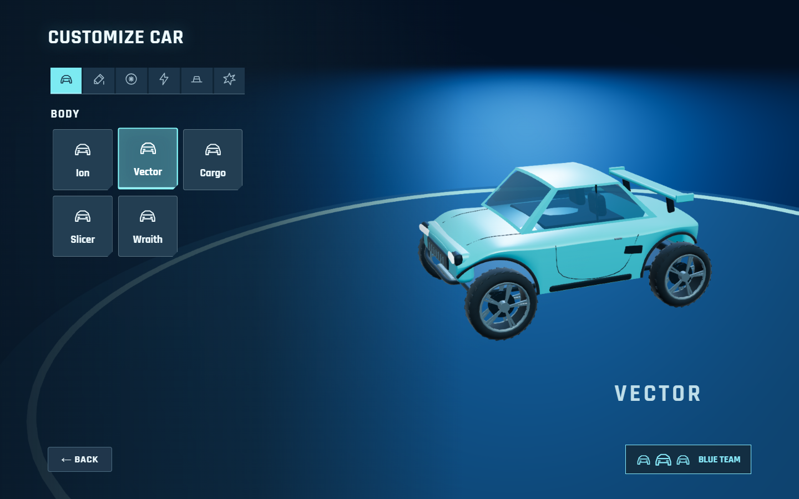
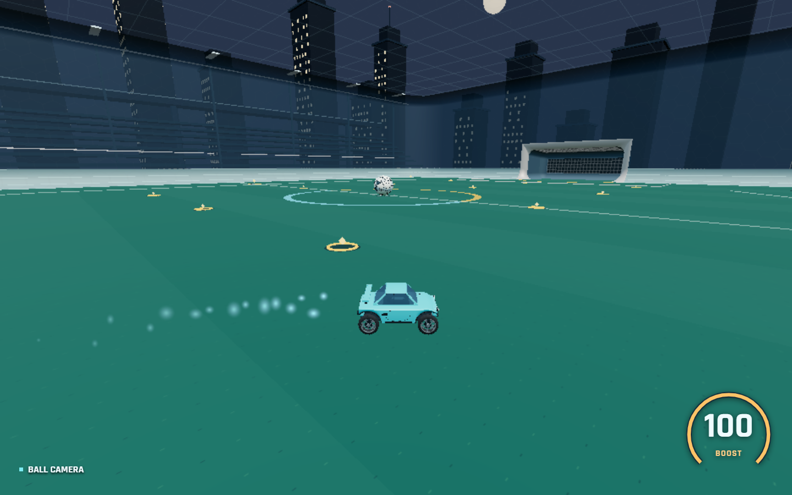

# Default Vector model quality pass

This documents the initial quality pass. See [the subsequent refinement pass](CAR-MODEL-REFINEMENT.md) for the current wheel placement, tint, silhouette and validation results.

Only the default **Vector** body was redesigned. Ion, Cargo, Slicer and Wraith retain their existing models. This is an original compact rally coupe built from code; no imported car meshes, branded artwork, or paid assets are used.

1. **Geometry strategy:** procedural Three.js geometry in `src/render/vector-model.ts`. `carModel()` remains the common factory for Garage, Home, local/network gameplay and replay. The existing preset and body IDs remain valid.

2. **Triangle count:** the standard Vector with Apex wheels and no topper renders **21,948 triangles nearby**, or **11,632 at distance**. The detailed shell is 13,436 triangles; the distant shell is 3,120. Topper and wheel choices vary the total; automated checks keep every wheel choice with a crown below 30k rendered triangles. Inactive LOD geometry is excluded from the rendered count.

3. **Body and materials:** a crowned hood/deck and rolled shoulders are sampled as smooth indexed surfaces. Side panels terminate around open wheel arches. The greenhouse has separate windshield, side and rear glazing, a crowned roof, narrow pillars and inexpensive seat silhouettes. The shell is merged into seven material batches: `BODY_PAINT`, `GLASS`, `RUBBER`, `METAL`, `DARK_TRIM`, `LIGHT`, and `TAIL_LIGHT`. Default wheels reuse the rubber, metal and trim, giving seven materials for the whole default car. Other wheel cosmetics may add their existing accent material. Paint receives the existing preset/team color.

4. **Rounded edges:** curved surface sampling handles the hood, fenders, roof, quarters and side transitions; normals are computed before batching. Rounded-box geometry softens bumper fasciae, lamp housings, wing, supports and small trim. Curved tubes define rolled arch lips and the compact guard. Sampled window surrounds follow the same curvature as the roof header to prevent cracks. Panel seams remain deliberate, narrow features.

5. **Windshield and headlights:** blue tinted physical glass uses 0.88 opacity, low roughness and a small shared procedural reflection environment. Lenses sit 0.003 units inside their surrounds; there is no opaque painted cabin behind them. The Home fade preserves each material's base opacity. Headlights have separate rounded dark housings and bright emissive lenses; rear lamps use their own red emissive material. No per-car point lights or live reflection captures are added.

6. **Wheels:** all Vector wheel cosmetics are scaled to **94%** of their previous visual size: radius **0.1692**, diameter **0.3384**, versus the unchanged physical radius of **0.18**. Tires retain a rounded profile; the default adds simplified tread and ten split spokes. Rear/other-side wheels share buffers and materials, with mirrored rim orientation. Other bodies retain their previous wheel appearance.

7. **Physics alignment:** physical dimensions, colliders, inertia, center of mass, handling, suspension/support solver and wheel mounts are untouched. Steering pivots remain at X = +/-0.435, Z = +/-0.49, Y = -0.12. Smaller visual wheels are offset down by **0.0108** inside those pivots, keeping their bottom at the original **-0.30** body-relative contact height. The body stays inside the tested roof/width envelope. The topper sits over the roof center; the existing exhaust/boost anchor is retained. Steering, wheel spin and recorded replay poses use the existing animation path.

8. **Performance:** the original Vector had 5,160 triangles and 32 mesh submissions. The new default uses **23 mesh submissions**, including its wheels, and seven reusable materials. At **12 world units**, a simpler shell replaces the detailed shell, with 12% hysteresis to avoid rapid switching. The shell loses about 77% of its triangles; the whole car loses about 47%. Both shells share materials; four wheels share GPU geometry. Geometry is generated on equip, with no per-frame tessellation. Disposal releases shared geometry/materials once. A single 128x64 reflection texture is reused for the application lifetime. These are geometry/submission measurements, not a hardware FPS benchmark.

9. **Validation:** `npm test`, `npm run build`, and `npm run test:car-model`. The model checks cover both LOD bounds, triangle budgets, finite normalized normals, exposed windshield/side glass/headlights, paint, shared wheel buffers, unchanged wheel mounting/contact height and LOD switching. Existing tests cover all 50 body/wheel and 55 body/topper combinations, driving physics, steering/spin and replay. `tests/car-model-quality-browser.cjs` exercises Home transparency, Garage and live gameplay, low/ultra shader compilation, distance LOD and steering/rotation using Chrome and Playwright. Screenshots below use the actual game renderer.

All validation commands passed: the full `npm test` suite (including the new model checks), `npm run build`, `npm run test:car-model`, and the Chrome browser test. Ultra shaders remained enabled without fallback. The build retains Vite's bundle-size advisory; no build errors occurred.

Garage at Ultra quality; gameplay at Low quality, using the normal gameplay camera.

