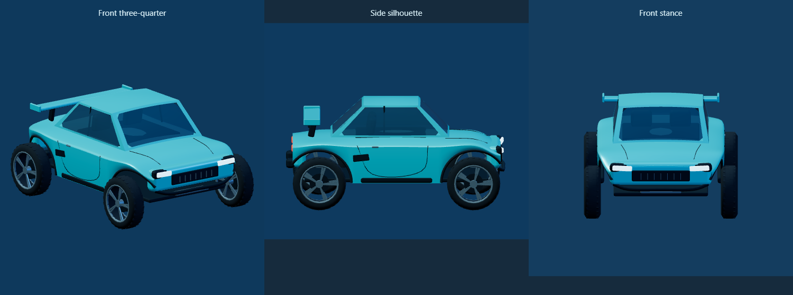
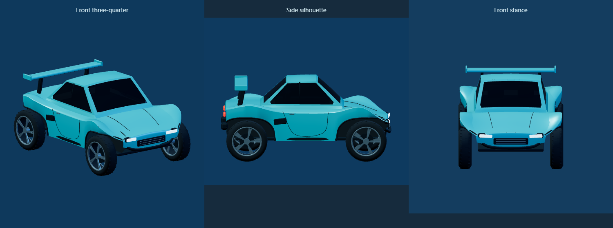
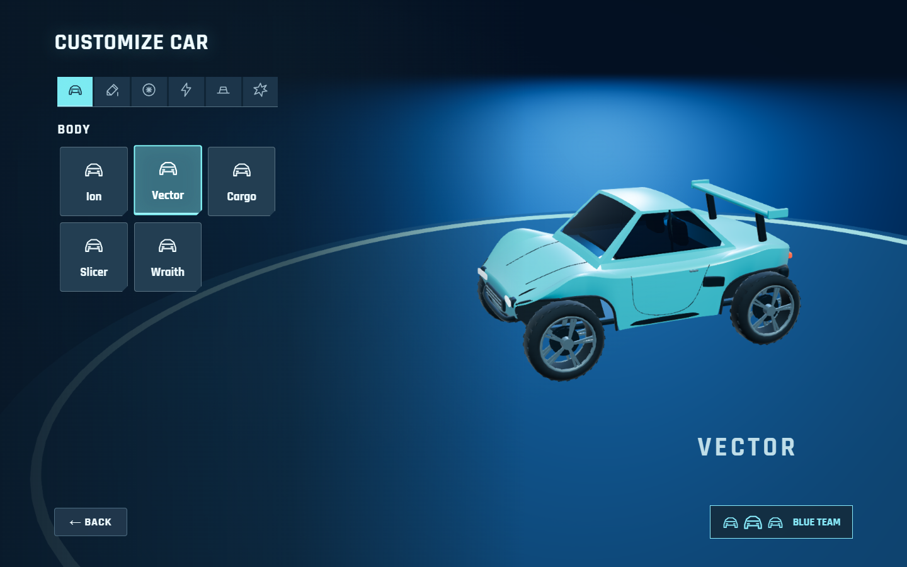
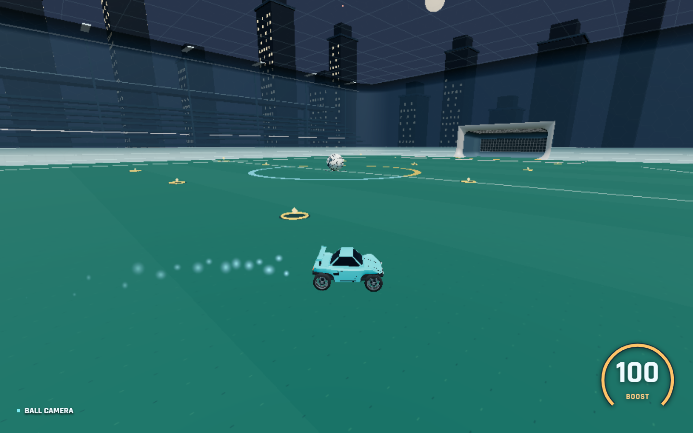

# Default Vector refinement pass

This refines the existing procedural Vector rather than replacing it. The other car bodies and gameplay physics are unchanged.

1. **Wheel placement.** Each visual wheel moves inward by **0.058 world units** inside its existing steering pivot. Neutral visual wheel centers move from X = +/-0.435 to **+/-0.377**; the physical mounts remain +/-0.435. Wheel radius, the previous 94% visual scale, axle locations and ground-contact height are retained. Spin still happens about the visual wheel center. Tests sweep both front wheels through **-0.55, 0 and +0.55 radians**, at two spin phases, for all ten wheel styles; upper tire vertices retain at least 0.008 units of clearance below the shaped arch openings.

2. **Window tint.** Glass changes from **#365a70 to #0d1b27**, with opacity **0.88 -> 0.97**. Nominal transparency drops from 12% to 3%, a **75% reduction**. Reflection intensity changes from 0.85 to 0.55 to keep highlights restrained. Glass remains transparent, reflective and blue tinted rather than opaque black. The existing inset curved lens/surround construction is preserved, fitted to the more compact cabin. The Home fade continues to respect base material opacity.

3. **Wheel covers.** The existing body loft now has a narrower waist and fuller axle shoulders. The openings use an asymmetric, broad-topped profile rather than simple semicircles; front and rear openings have different leading/trailing rake. Low, crowned cover panels sweep into the hood and rear quarters, with rolled arch lips. Front openings account for the inward-offset wheels' steering sweep. Tighter vertical openings and recessed inner liners prevent bright background showing through above the tires; the liners sit clear of the steering sweep and taper away at the bumpers. Near and distant geometry use the same profiles.

4. **Silhouette.** The hood slopes into a narrower, rolled prow, replacing the previous full-width bumper slab. Lamp housings follow the narrower face; a shallow horizontal intake and compact bow guard retain an original front identity. The roof is **31% shorter** and about **8% narrower**, with a gently descending rear section, while its peak stays within the existing collision roof. The longer exposed hood, shorter greenhouse, stronger axle shoulders and higher rear wing make the side profile more like a compact arena performance car. Small paint bridges connect the revised cabin to the hood and waist without gaps. The topper is centered on the revised roof; the boost anchor is unchanged.

5. **Compare/refine process.** Fixed front, side and three-quarter cameras were used for repeated comparison with the supplied reference. The sequence was: capture the previous model; correct the floating wheel stance and glass; sculpt the axle covers and shorten the cabin; reject the overly bulbous cover crests and reshape the mismatched bumper; then lower the rear shoulders, check steering clearance and remove excess subdivisions. The actual Garage view prompted a final round to tighten the wheel-to-arch gap and add recessed liners. Intermediate renders are retained in `.tools/vector-refine-*.png`. The comparison below uses the same cameras and lighting before and after.

6. **Originality.** Only broad proportions and body language were taken from the reference: a compact cockpit, sloping nose, pronounced wheel covers and raised wing. The existing original Vector loft, asymmetric opening profiles, panel flow, horizontal intake, lighting and bow guard remain independently constructed. No official mesh, topology, branded panels, textures or logos are imported or reproduced.

7. **Performance.** The default Apex-equipped car renders **22,052 triangles nearby**, versus 21,948 before (**+104 triangles / 0.47%**). Distant geometry renders **11,808**, versus 11,632 (**+176 / 1.51%**). The car retains **23 mesh submissions, seven shared materials, 18 unique geometry buffers**, the existing 12-unit body LOD and wheel buffer sharing. New cover/cowl geometry was offset by reducing unnecessary subdivisions across the narrow window-surround strips. No new textures, runtime captures or per-frame geometry generation are introduced. These are geometry measurements, not an FPS benchmark.

8. **Validation.** Run `npm test`, `npm run build`, and `npm run test:car-model`. Geometry checks cover both LOD bounds, normals, tint, exposed lenses, inward wheel positions, steering clearance, unchanged physical pivots/contact height, paint and shared wheel buffers. The Chrome test covers Home/Garage/gameplay rendering, Low/Ultra shaders without fallback, steering/spin, LOD and the unchanged attached boost outlet. Existing wheel/topper/preset, replay, multiplayer, camera and physics tests remain in the full suite.

Validation result: **all commands passed**, including the full `npm test` suite, `npm run build`, `npm run test:car-model`, and the Chrome browser test. Low/Ultra rendering completed without runtime/shader errors or Ultra fallback. Vite retains its existing large-chunk advisory.

| Before refinement                                | After refinement                                    |
| ------------------------------------------------ | --------------------------------------------------- |
|  |  |

