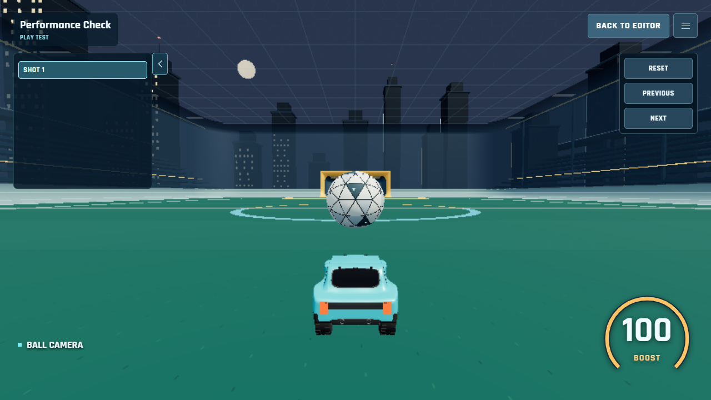
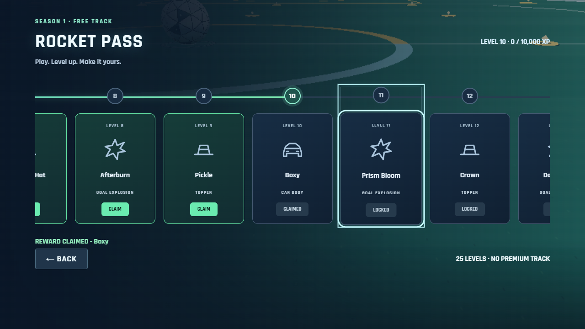

# Octane Arena: four focused improvements

Implemented and validated on October 27, 2026 in C:/Users/Public/Octane-Arena-New.

## Multiplayer architecture and rates

The previous checkout already targeted **120 Hz physics and 30 Hz snapshots**, with 100 ms interpolation and 120 ms maximum extrapolation. The reported roughly 10 FPS appearance was not evidence of a configured 10 Hz snapshot loop. A pre-change production receive-rate measurement is unavailable.

Inspection found three concrete problems: motion, input, party control and replay chunks shared one reliable ordered PeerJS channel; prediction used render-frame input sequences for multiple physics ticks; and its collision world contained no enabled ball or opponent colliders. Buffered cars and the ball could be about 100 ms behind the predicted local car. Sparse snapshots also omitted a collision's intervening trajectory corner.

| Path | Before | After |
| --- | --- | --- |
| Authoritative physics | 120 Hz worker | 120 Hz worker |
| Client fixed physics | 120 Hz local-car prediction | 120 Hz car/ball prediction with remote colliders |
| Important state | 30 Hz target | 30 Hz target, unchanged |
| Inputs | About 30 Hz, latest input | About 30 Hz, redundant batches of fixed-tick commands |
| Control/replay transport | Same ordered reliable channel as motion | Reliable control/replay channel |
| Motion/input transport | Ordered reliable channel | Separate unordered SCTP channel, maxRetransmits 0 |
| Metadata | 5 Hz plus event changes | 5 Hz plus event changes |
| Remote presentation | Timestamp buffer | Timestamp buffer plus authoritative collision checkpoints |

The motion channel uses the existing authenticated PeerJS peer connection. Routing explicitly preserves PeerJS's control-channel handler. Until the motion channel opens, traffic can fall back to control. Replaceable traffic has bounded buffering instead of queuing stale movement.

**Prediction:** throttle, brake, steering, boost, jump/dodge, air roll and powerslide immediately run the normal car physics. Each 120 Hz step records a unique command sequence and local tick. The host processes queued commands in order, acknowledges the sequence/tick actually consumed, and holds the last processed input between batches. Validation and bounded redundant history tolerate duplicates and loss without applying new jump/power edges ahead of their commands. AI decisions remain exclusively on the host.

**Reconciliation:** seed from authoritative car, ball and remote state; discard acknowledged commands; replay the remaining commands. Position and quaternion presentation offsets decay smoothly (12/s, faster at 35/s for large collision corrections). Explicit reset, teleport, enable/disable changes and errors above 6 m snap. Prediction stops after stale authority rather than running indefinitely.

**Remote cars and ball:** authoritative tick/time buffers are bounded to 32 snapshots. Render about 100 ms behind authority with position interpolation and quaternion slerp. Late data can extrapolate linear/angular velocity for at most 120 ms. Camera subjects use the resulting rendered poses. Reset sequences, respawns and Swapper teleport sequences avoid cross-map interpolation.

**Collision feedback:** the prediction world includes the ball and kinematic remote cars using the same arena, car shapes and mutators. Proxies receive swept kinematic targets every fixed tick. Existing car-ball contact response produces immediate speculative feedback. Close interactions blend cars and ball onto that coherent predictive timeline; distant objects retain buffered presentation. The host alone awards touches, goals, damage, demolitions, power-ups and final ball outcomes.

The host additionally records 120 Hz post-contact/major-impulse checkpoints, retaining at most 12 for 350 ms. Buffered presentation inserts these impact poses between ordinary snapshots; confirmed impacts clear stale speculative ball offsets promptly. Dropshot floor topology and Heatseeker state are mirrored for prediction. Active Rumble forces and spike attachments use the host's ball trajectory instead of a speculative free ball.

**Diagnostics:** disabled by default. Open the game with ?netdebug to see RTT, input/state send rate, receive rate, interpolation delay, buffer size, dropped/out-of-order counts, positional/angular correction and gameplay payload bandwidth. Application payload counts exclude SCTP/IP overhead and replay/control traffic.

### Actual browser acceptance

Independent Chrome contexts exercised a host, moving guest and spectator in all five modes, plus 2v2 with bots. Separate four-human 2v2 verified independent predictions, shared authority, bounded buffers and leave cleanup with 100 ms latency, 25 ms jitter and 5% loss. The all-mode run used 60 ms latency, 18 ms jitter and 6% replaceable-state loss.

| Mode / format | Received Hz | Render FPS | Receive KiB/s | Send KiB/s |
| --- | ---: | ---: | ---: | ---: |
| soccar 1v1 | 28.6 | 32.0 | 83.1 | 19.3 |
| soccar 2v2bots | 27.2 | 29.5 | 139.9 | 19.2 |
| heatseeker 1v1 | 23.2 | 35.2 | 74.0 | 20.3 |
| hoops 1v1 | 23.3 | 47.4 | 68.4 | 20.4 |
| dropshot 2v2bots | 15.1 | 31.4 | 122.0 | 17.6 |
| rumble 1v1 | 24.6 | 32.0 | 73.5 | 21.9 |

An earlier lighter all-mode run received 26.7-28.6 Hz and rendered 46.8-59.2 FPS. The stricter moving-player run above includes software-rendering/CPU contention; it does not prove 60 FPS on every device. Movement was verified between packet arrivals, and all tests passed with bounded buffers. A transient Heatseeker hard correction occurred; the other final mode samples had none. This is not a guarantee of zero visible correction or zero latency.

Remaining limits: internet NAT/firewall traversal and public signaling availability are unchanged; local signaling was used for repeatable acceptance. No new TURN service was deployed. Long outages hold state after the extrapolation budget. Speculative collision outcomes can differ from the host, particularly under Rumble forces, crowded contacts or severe loss, and must reconcile. High upload fan-out and device CPU/GPU limits still affect performance. Full world metadata is not sent at 60 Hz.

## Custom Training PLAY SHOT

Trajectory prediction was already gated to Edit mode. The actual redundant work found was the hidden TransformControls/editor hierarchy remaining in scene matrix traversal and editor pointer controls remaining connected. In addition, play rendering used the newest physics pose instead of the fixed loop's residual interpolation alpha.

PLAY SHOT now removes a dedicated editor-only subtree (gizmos, trajectory dots, arrows and handles), disconnects editor orbit/transform listeners, and leaves authoring prediction and placement logic paused. Edit mode reconnects and restores them. Physics continues through the shared 120 Hz fixed loop, with ordinary pose interpolation and one render loop. Detached resources are still disposed correctly.

Browser profiling: scene nodes **569 -> 472**; helper matrix updates during play **0**; trajectory prediction counter unchanged **1 -> 1**; **156 steps at 120.0 Hz**. Median isolated matrix traversal fell from **0.247 ms hidden to 0.180 ms detached** (about 27%). This measures that traversal only, not a 27% overall FPS gain. Last sampled play-update work was about 2.6 ms, excluding drawing. Play/Edit restoration, saving and cleanup tests passed.

## Free Season 1 Rocket Pass

Home places ROCKET PASS directly below Garage and above Settings. The dedicated horizontal 25-card track has connected fractional level progress, clear locked/green claimable/claimed states, controller focus navigation, hidden scrollbars and a short claim animation. There is no premium track or separate XP currency.

Rewards are data-driven in shared/rocket-pass.ts. Existing cosmetic meshes/effects are reused; the final four toppers are lightweight color variants.

| Level | Type | Reward | Item ID | Bonus boost |
| ---: | --- | --- | --- | --- |
| 1 | TOPPER | Propeller Beanie | beanie |  |
| 2 | GOAL EXPLOSION | Confetti | confetti |  |
| 3 | TOPPER | Top Hat | top-hat | Ember |
| 4 | GOAL EXPLOSION | Arcstorm | electric |  |
| 5 | TOPPER | Cat Ears | cat-ears |  |
| 6 | GOAL EXPLOSION | Bubble Pop | bubbles | Slipstream |
| 7 | TOPPER | Birthday Hat | birthday |  |
| 8 | GOAL EXPLOSION | Afterburn | inferno |  |
| 9 | TOPPER | Pickle | pickle | Ion Drive |
| 10 | CAR BODY | Boxy | boxy |  |
| 11 | GOAL EXPLOSION | Prism Bloom | crystal |  |
| 12 | TOPPER | Crown | crown | Arc |
| 13 | GOAL EXPLOSION | Databurst | digital |  |
| 14 | TOPPER | Traffic Cone | cone |  |
| 15 | GOAL EXPLOSION | Blue Horizon | blue-wash | Heatwave |
| 16 | TOPPER | Halo Ring | halo |  |
| 17 | GOAL EXPLOSION | Quarry | debris |  |
| 18 | TOPPER | Tiny UFO | ufo | Stardust |
| 19 | GOAL EXPLOSION | Violet Eclipse | violet-wash |  |
| 20 | CAR BODY | Wedge | wedge |  |
| 21 | TOPPER | Pirate Hat | pirate | Astral |
| 22 | TOPPER | Emerald Top Hat | emerald-hat |  |
| 23 | TOPPER | Solar Halo | solar-halo |  |
| 24 | TOPPER | Frost Crown | frost-crown | Byte Stream |
| 25 | TOPPER | Violet UFO | violet-ufo | Dune |

Only **Level 10 Boxy** and **Level 20 Wedge** award car bodies.

New profiles own **Vector and LowFlat**, **zero toppers** (None is always selectable), and **Pulse** as their one goal explosion. Plasma is the only starter boost. The nine other boosts are bonus rewards at levels 3, 6, 9, 12, 15, 18, 21, 24 and 25, leaving every original reward intact. Existing claims receive their matching bonus boosts, and boosts used in old saved presets remain owned. Unowned items are hidden from the Garage entirely; they appear after unlocking.

Garage saves now include versioned owned-item lists and per-season claimed levels alongside existing presets. Inventory version 3 removes the earlier migration's blanket grant of the original catalog. New and default saves retain only the starter inventory; Rocket Pass claims, cosmetics used in existing saved presets, and partial explicit ownership are preserved. Unused automatically granted cosmetics return to their Rocket Pass unlocks.

Claim verifies the current account level and missing claim receipt, then adds ownership and the receipt in one immediately saved JSON document. Web Locks serialize multi-tab claims where available; union merging preserves ownership and prevents duplicate grants. Refresh, repeat claims, mixed-tab claims, equip locks and legacy saves are covered. If browser storage is unavailable, the UI identifies session-only persistence.

The existing XP ledger and xpRequired() supply all progression. Progress between nodes is (accountLevel - 1 + currentLevelXP / requiredXP) / 24, clamped to 0-1. Account leveling beyond 25 continues normally; Season 1 rewards stop at 25. No automatic claims or second XP economy were added.

## Horizon-level gameplay camera

Every final gameplay orientation is rebuilt from desired look direction and **WORLD_UP (0,1,0)**. Car and surface rotations can select a heading, but cannot roll the gravity reference. The explicit orthonormal basis preserves a stable horizontal right axis near both vertical poles. Shake is also reprojected through this basis so it cannot introduce roll.

Car Cam, Ball Cam, free-look return, reverse view, wall/ceiling transitions and aerial tumble use the same rule. Follow and mode changes retain rate limits and smooth positions. Near-vertical reverse view has a heading fallback. Tests cover walls, ceilings, overhead balls, transitions, free look, toggles and shake at 30/60/144 FPS, including pole noise and non-inverted up vectors.

Existing arena-shell pass-through and local occlusion fading remain active; boundary walls do not shorten the boom. Floors and deliberately hard camera obstacles retain clearance. Two older tests expecting wall-frame roll/field-side wall confinement were updated to the requested world-up and pass-through contract; framing and readability checks remain.

## Validation

- npm test: **PASS**, full repository suite.
- npm run build: **PASS**, strict TypeScript and production assets; existing large-bundle advisory remains.
- npm --prefix server test: **28 PASS, 0 failed**.
- npm --prefix server run build: **PASS**.
- npm run test:rtc: **PASS**, replay chunks, lifecycle and signaling/schema validation.
- npm run test:camera and npm run test:four-upgrades: **PASS** after final camera/telemetry refinements.
- tests/network-smoothing-browser.cjs: **PASS**, host/guest/spectator, all modes, bots, latency/jitter/loss, actual motion-channel settings and between-packet movement.
- tests/network-four-browser.cjs: **PASS**, four independent human clients, 2v2 and disconnect cleanup.
- tests/four-upgrades-browser.cjs: **PASS**, live existing XP, claims, refresh, locked equipment, controller track navigation and training play/edit performance.
- npm run test:training-cloud: **PASS** with isolated Auth/Firestore emulators for demo-octane-training. Two clients exercised publish/read/download/update, foreign-owner and forged-write denial, rapid-publish deduplication, pagination, malformed packs, unpublish and feedback rules. Production Firebase data/settings were not changed.

Machine-readable measurements: [four-upgrades-validation.json](four-upgrades-validation.json). Full command logs remain under .tools/. Browser tests accept PLAYWRIGHT_MODULE; optional PEER_TEST_MODULE points to a test-only PeerServer installation, leaving production PeerJS configuration unchanged.

Reference APIs: [PeerJS DataConnection](https://peerjs.com/client/api/data-connection), [Rapier kinematic body positioning](https://rapier.rs/docs/user_guides/javascript/rigid_body_position/).

## Play locally

Run npm run dev from this folder, then open http://127.0.0.1:5173/Octane-Arena/. In VS Code, use the Command Palette's Simple Browser: Show and paste that URL. Add ?netdebug for the optional diagnostics overlay. The dev server is running on port 5173 at completion.
