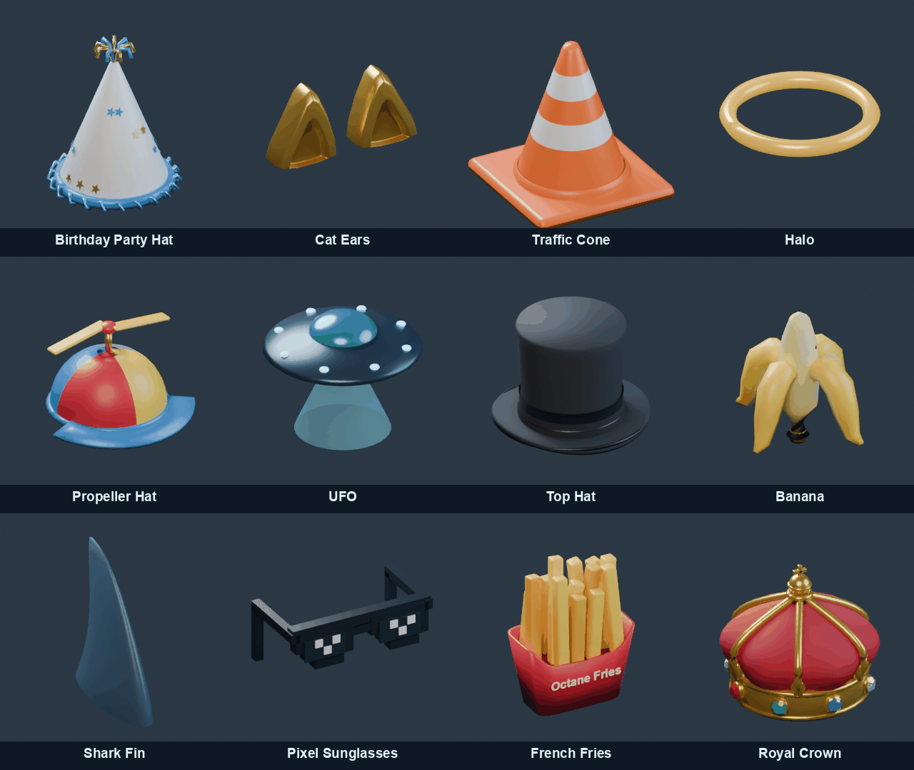

# Blender topper collection

Twelve original Octane Arena accessories modeled, exported, inspected and rendered through the installed Blender MCP 1.8 server / MCP stdio client, in Blender 5.2.3 LTS. References are the twelve corresponding images in `Reference Images/`; no reference model or branded mesh was imported.

Editable source: `art/blender/octane-arena-toppers.blend`. One collection per topper; crown visible initially. All roof origins are local Z=0 in Blender, +Y forward; glTF exports Y up and -Z forward at native metre scale. Separate `PropellerHat/Propeller` and `UFO/Body`, `UFO/Beam` nodes are retained. Static details are joined into material batches (at most nine draw groups).

| Item ID | GLB | Triangles | Static thumbnail |
| --- | --- | ---: | --- |
| `birthday` | `public/models/toppers/birthday-hat.glb` | 2,132 | `public/images/toppers/birthday-hat.png` |
| `cat-ears` | `public/models/toppers/cat-ears.glb` | 1,248 | `public/images/toppers/cat-ears.png` |
| `cone` | `public/models/toppers/traffic-cone.glb` | 908 | `public/images/toppers/traffic-cone.png` |
| `halo` | `public/models/toppers/halo.glb` | 1,168 | `public/images/toppers/halo.png` |
| `beanie` | `public/models/toppers/propeller-hat.glb` | 1,696 | `public/images/toppers/propeller-hat.png` |
| `ufo` | `public/models/toppers/ufo.glb` | 3,696 | `public/images/toppers/ufo.png` |
| `top-hat` | `public/models/toppers/top-hat.glb` | 2,024 | `public/images/toppers/top-hat.png` |
| `banana` | `public/models/toppers/banana.glb` | 808 | `public/images/toppers/banana.png` |
| `shark-fin` | `public/models/toppers/shark-fin.glb` | 800 | `public/images/toppers/shark-fin.png` |
| `pixel-sunglasses` | `public/models/toppers/pixel-sunglasses.glb` | 240 | `public/images/toppers/pixel-sunglasses.png` |
| `octane-fries` | `public/models/toppers/octane-fries.glb` | 1,766 | `public/images/toppers/octane-fries.png` |
| `crown` | `public/models/toppers/royal-crown.glb` | 5,448 | `public/images/toppers/royal-crown.png` |

Triangle counts are actual exported meshes. Pixel glasses deliberately use only 240 triangles. The 5,448-triangle crown earns its higher budget through its cushion, six real gold arches, rolled band, eight raised jewel settings and top ornament; the saucer uses 3,696 triangles. Twelve GLBs total 578 KB; 320px palette PNG thumbnails total 503 KB. No live thumbnail scenes.

## Materials and construction

PBR metallic/roughness materials match the existing car rendering. Instance materials share the car's 128x64 reflection source; immutable geometry and embedded textures are cached once. Material state and animated transforms belong to each instance. Disposal of one car never frees another car's shared buffers. Fabric/paper is rough, plastic moderately glossy, gold metallic (.78 metalness/.26 roughness), gems glossy and simply faceted.

- Party hat: rounded cone, original blue/gold constellation stars, a limited ring of folded blue tinsel and nine top streamers. No copied text.
- Cat ears: paired rounded gold shells with real backward depth and recessed amber inner bowls.
- Cone: rounded square base, orange taper/lip and two reflective white bands.
- Halo: warm emissive gold torus with luminous core, floating without a pole.
- Propeller: rounded four-color cap, curved thick brim and independent two-blade rotor.
- UFO: dark alloy saucer, blue dome, underside ring, eight emissive perimeter lights and one open beam cone. Beam is separate, opacity .14, additive blending, front-side culling, depth testing on, depth writing off, no shadows, render order 2. It tapers from .118m at the roof to .037m at the emitter. Base alpha is retained during lobby fades. No particles or colliders.
- Top hat: curved broad brim, subtly shaped dark felt crown and black satin band.
- Banana: curved cream flesh with four substantial hanging yellow peels and small friendly eyes.
- Shark fin: a swept, smoothed dorsal fin only, directly at the roof origin. No water, shark body or pedestal.
- Glasses: thick stair-step black frames, smoky inset lenses, white pixel highlights and short 3D arms; intentionally unsmoothed.
- Fries: shaped red carton, fourteen varied golden fries and a separate front decal. Exact **Octane Fries** lettering is baked into one packed 256x64 RGBA texture, not dense text geometry.
- Crown: deep crimson rough velvet cushion with six bulging gores, solid gold lower band/rolled edges, six gold arches, upper collar/orb/cross and eight faceted ruby, emerald, sapphire and pale jewels in gold lower-band settings.

## Mounts and animation

The existing GLB roof attachment calculation is retained. There are no arbitrary per-topper scale factors. All 48 combinations were checked with the actual four GLB bodies. Mount positions in car space (x, y, z), including the existing .008m roof clearance:

| Body | Mount |
| --- | --- |
| Vector | (0, .250603, .081745) |
| LowFlat | (0, .136534, .169903) |
| Boxy | (0, .330219, .135994) |
| Wedge | (0, .189023, .121217) |

A small `animateTopper` hook runs before both wheel-animation branches, including recorded/remote/replay poses. It derives the propeller target from existing `car.grounded`, accelerates exponentially toward 15 rad/s airborne and coasts toward zero on landing; angular integration is frame-rate independent. Each car has its own rotor. Garage previews demonstrate the same spin/coast cycle, respecting reduced motion. No physics, hitbox, centre of mass, suspension, car assets, gameplay camera code or network packet fields changed. The Garage topper category uses a closer roof inspection view so small details and lettering can be inspected; other Garage categories retain their framing. Multiplayer still sends only the preset topper ID.

## Catalog and migration

Eight equivalent IDs remain (`birthday`, `cat-ears`, `cone`, `halo`, `beanie`, `ufo`, `top-hat`, `crown`); four new IDs complete the exact reference set. `none` remains available. Retired selectable items migrate narrowly: pickle -> banana, pirate -> shark-fin, emerald-hat -> top-hat, solar-halo -> halo, frost-crown -> crown, violet-ufo -> ufo. Unknown IDs still fail strict shared validation.

Local inventory version 4 migrates explicit ownership and every preset, preserves claim receipts and previously customized items, and freezes the historical v1 blanket-grant list. Earlier level 22-25 receipts preserve their canonical old topper entitlements as well as replacement rewards. Rocket Pass still has 25 unique primary rewards and unchanged level 10/20 bodies: levels 9/21 now grant banana/fin, 22/23 grant glasses/fries, 24/25 promote their existing Byte Stream/Dune boost bonuses to primary rewards. Duplicate receipts remain rejected. Optional legacy SQLite accounts receive idempotent canonical ownership copies and topper-only preset migration; original ownership rows stay archived.

All twelve Garage cards show rendered thumbnails, names and OWNED/LOCKED states. Locked cards support click and keyboard/controller focus previews through an ephemeral preset copy; they never equip or write to saves. Other categories retain their ownership rules. There is one main 3D preview, not twelve live scenes.

## Rebuild

1. Run `python art/blender/bake_fries_label.py` with Pillow to bake the small original lettering texture.
2. In the connected Blender MCP `execute_blender_code` tool, load `art/blender/build_topper_collection.py` into its execution namespace and call `build()`. It exports all twelve GLBs, the manifest and editable source. Use a fresh dedicated Blender scene: the build replaces its scene.
3. Using the same definitions, call `render_thumbnail(slug)` for each manifest entry through MCP (one render per request). Cycles 24 samples, standardized three-softbox rig, orthographic front three-quarter camera, AgX, neutral dark background, consistent framing.
4. Call `save_source()` through MCP to restore the organized editable source view. Run `python art/blender/optimize_topper_thumbnails.py` for the small PNG palette files.

## Validation

- **PASS — `npm test`**: complete regression command, exit 0, including the new asset tests and existing physics, camera, challenges, XP, networking and car checks.
- `npm run test:toppers`: twelve parsed real GLBs, actual triangle/material budgets, 48 real GLB body mounts, all fallbacks, instance/disposal isolation, packed decal/UVs, beam alpha, smooth airborne/landing/recorded and frame-rate-independent animation, unchanged physics constants, strict preset and entitlement/receipt migration.
- `tsx --test server/tests/topper-migration.test.ts`: all six SQLite migrations across two restarts, preserving preset fields, revisions, selected preset and original entitlements.
- `tests/topper-collection-browser.cjs`: Chromium renders/decodes all twelve thumbnails and GLBs; locked click/focus preview stays unsaved, all 48 equips/save, refresh, a real Free Play jump/landing, home beam fade and individual failed-GLB fallback; checks JS/WebGL errors.
- `tests/topper-multiplayer-browser.cjs`: two actual local PeerJS Chromium clients with an isolated local signaling server verify synchronized IDs/real models, beam alpha, and local/remote propeller animation on an actual jump, without angle/state packet fields.
- `npm run build` and `npm --prefix server run build`: production frontend and server compilation.

Browser checks use the installed Chrome and Playwright (`PLAYWRIGHT_MODULE` may point to its existing local installation). No deployment was performed.

Completion: frontend production build, focused asset tests, SQLite migration tests, Chromium selection/gameplay/failure checks, and the two-client PeerJS test all passed (exit 0). Server production compilation also passed. Vite retains its existing large-bundle warning. Benchmark JSON rewritten by the regression suite was restored; existing Blender car assets are untouched.
